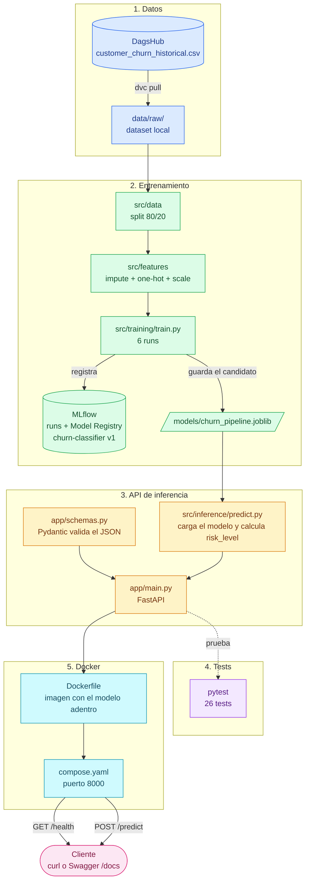
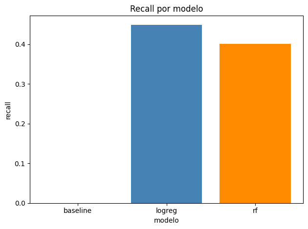

# customer-churn-ml-j-a

Prediccion de abandono de clientes (churn).

| | |
|---|---|
| **Institucion** | ISTEA |
| **Materia** | Laboratorio de Mineria de Datos |
| **Año / cuatrimestre** | 2026 — 2.º cuatrimestre |
| **Equipo** | Rodolfo Berrone y Andrea Romeo |
| **Entrega** | 2da entrega (tag `entrega-2`) · la 1ra esta en el tag `entrega-1` |

Clasificacion binaria: estimar si un cliente de telecomunicaciones se va (`Churn`).

## Como funciona (entrega 2)

Asi viaja un cliente desde los datos hasta la respuesta de la API.



### Que hace cada parte

| Parte | Que hace |
|---|---|
| **1. Datos** (azul) | El CSV esta en DagsHub. Con `dvc pull` se baja a `data/raw/`. |
| **2. Entrenamiento** (verde) | `train.py` separa train/test, preprocesa, entrena los modelos y los anota en MLflow. El candidato (logreg) queda en el Model Registry y en `models/` como joblib. |
| **3. API** (amarillo) | Pydantic revisa que el JSON este bien. `predict.py` usa el joblib y devuelve `prediction`, `probability`, `risk_level` y `model_version`. |
| **4. Tests** (violeta) | `pytest` prueba la carga del modelo, una prediccion valida, `/health`, `/predict` y entradas invalidas. |
| **5. Docker** (celeste) | El Dockerfile arma la imagen con el modelo adentro y compose la levanta en el puerto 8000. |
| **Cliente** (rosa) | Llama a `/health` para ver si anda y a `/predict` para pedir la prediccion. |

### Que devuelve la API

| Caso | Codigo |
|---|---|
| Todo bien | `200` |
| JSON mal (falta un campo, tipo o valor incorrecto) | `422` |
| No esta el modelo | `503` |

## Hasta ahora

Notebooks de eda y exploracion:

1. [notebooks/01_eda.ipynb](https://github.com/javi2481/customer-churn-ml-j-a/blob/main/notebooks/01_eda.ipynb)
2. [notebooks/02_exploracion_modelos.ipynb](https://github.com/javi2481/customer-churn-ml-j-a/blob/main/notebooks/02_exploracion_modelos.ipynb)

Entrenamiento por consola (misma logica que el notebook 02):

```text
python -m src.training.train
```

El train unico se partio en `src/` asi:

- `src/data/dataset.py` — lee el CSV y hace el split 80/20
- `src/features/preprocessor.py` — impute, one-hot y scale
- `src/training/train.py` — corre ≥6 runs y los anota en MLflow
- `src/evaluation/metrics.py` — accuracy, precision, recall, F1, ROC-AUC

Para ver los experimentos (y el Model Registry):

```text
mlflow ui --backend-store-uri ./mlruns
```

El candidato queda registrado como `churn-classifier` (sale del run `logreg_C1`).

DVC implementado. El dataset se encuentra versionado mediante DVC y fuera del control directo de Git.

## Candidato oficial

Fuente de verdad: metricas del notebook ejecutado `notebooks/02_exploracion_modelos.ipynb` (split 80/20, `random_state=42`, `stratify=y`).

**Candidato:** `LogisticRegression(C=1.0, max_iter=1000, random_state=42)` dentro del Pipeline de preprocessing.

| modelo | accuracy | precision | recall | f1 | roc_auc |
|---|---:|---:|---:|---:|---:|
| baseline (`most_frequent`) | 0.736 | 0.000 | 0.000 | 0.000 | 0.500 |
| **logreg C=1 (candidato)** | **0.794** | 0.663 | **0.449** | **0.535** | **0.812** |
| random forest 100 | 0.783 | 0.642 | 0.401 | 0.493 | 0.790 |



Nos importa sobre todo el **recall**: un falso negativo (cliente que se va y el modelo no avisa) cuesta mas que un falso positivo (llamar de mas).

- El baseline siempre predice “no se va”. Accuracy ~74%, recall 0. Por eso Accuracy no decide.
- Logreg gana a RF en recall, F1 y ROC-AUC.
- `class_weight='balanced'` **no es el candidato todavia**: no esta corrido en el notebook. Entra como run extra de MLflow. Si mejora recall, se actualizan juntos README, tabla y Model Registry.

El detalle (graficos y matriz) esta en [02_exploracion_modelos.ipynb](https://github.com/javi2481/customer-churn-ml-j-a/blob/main/notebooks/02_exploracion_modelos.ipynb).

## Estructura

```text
customer-churn-ml-j-a/
├── data/raw/            # csv historico
├── notebooks/
│   └── figuras/         # graficos de la exploracion
├── src/
│   ├── data/
│   ├── features/
│   ├── training/
│   ├── evaluation/
│   └── inference/
├── app/                 # FastAPI (/health, /predict)
├── examples/            # payloads del curso para /predict
├── tests/
├── monitoring/
├── models/
├── scripts/
├── .github/
├── Dockerfile
├── compose.yaml
├── requirements.txt
├── .gitignore
├── .dockerignore
└── README.md
```

## Dataset

El dataset utilizado es:

`data/raw/customer_churn_historical.csv`

Esta versionado con DVC y alojado en DagsHub:

https://dagshub.com/javi2481/customer-churn-ml-j-a

No forma parte del control de versiones directo de Git.

### Configurar el remote (una vez por maquina)

El `.dvc/config` del repo ya apunta al storage. Falta autenticar en local con un token de DagsHub (Settings → Access → Tokens):

```bash
dvc remote modify origin --local access_key_id <TOKEN>
dvc remote modify origin --local secret_access_key <TOKEN>
```

Eso se guarda en `.dvc/config.local` (no se sube a Git).

### Recuperar el dataset

```bash
dvc pull
```

Para comprobar el estado de los datos:

```bash
dvc status
```

## Reproducir el entrenamiento

Instalar dependencias:

```bash
pip install -r requirements.txt
```

Incluye `dvc[s3]` para poder hacer `dvc pull` contra el remote de DagsHub.

Recuperar el dataset:

```bash
dvc pull
```

Ejecutar el entrenamiento:

```bash
python -m src.training.train
```

El entrenamiento deja registrados los experimentos en MLflow y genera el modelo candidato en `models/`.

## API de inferencia (entrega 2)

La capa de inferencia carga el mismo joblib del candidato:

```text
python -m src.inference.predict examples/predict_request_valid.json
```

API con FastAPI (Swagger en `/docs`):

```text
uvicorn app.main:app --reload --port 8000
```

- `GET /health` — si el servicio responde y que version de modelo cargo
- `POST /predict` — body = `examples/predict_request_valid.json`
- Respuesta: `prediction`, `probability`, `risk_level` (`LOW`/`MEDIUM`/`HIGH`), `model_version`

Los ejemplos de payload vienen del paquete de datos del curso (`examples/`).

Si el JSON esta mal (falta un campo, tipo incorrecto o valor que no existe) la API devuelve `422`.
Si no esta el modelo, `/health` y `/predict` devuelven `503`.

## Tests

```bash
pytest
```

Que prueban:

- `test_model_loader.py` — que el modelo exista y se pueda cargar
- `test_predictor.py` — una prediccion valida, tipos de la respuesta y umbrales de `risk_level`
- `test_health.py` — el endpoint `/health`
- `test_predict.py` — el endpoint `/predict` con datos validos e invalidos (422)
- `test_data_schema.py` y `test_preprocessing.py` — columnas del dataset y preprocesamiento

Para correrlos hace falta el dataset (`dvc pull`) y el modelo (`python -m src.training.train`).

## Docker

El modelo va adentro de la imagen, asi que primero hay que generarlo:

```bash
dvc pull
python -m src.training.train
```

Levantar la API:

```bash
docker compose up --build
```

Probarla (en otra terminal):

```bash
curl http://localhost:8000/health
curl -X POST http://localhost:8000/predict -H "Content-Type: application/json" -d @examples/predict_request_valid.json
```

Swagger: http://localhost:8000/docs

Ver logs y apagar:

```bash
docker compose logs
docker compose down
```

## Estado actual

- Notebooks de EDA y exploracion terminados.
- Entrenamiento reproducible desde consola.
- Preprocesamiento separado en modulos.
- MLflow y Model Registry integrados.
- Dataset versionado con DVC.
- Dataset almacenado en DagsHub mediante remote DVC.
- Inferencia por consola + API `/health` y `/predict` (FastAPI).
- Tests con pytest (API y logica de inferencia).
- API en Docker y Docker Compose.
